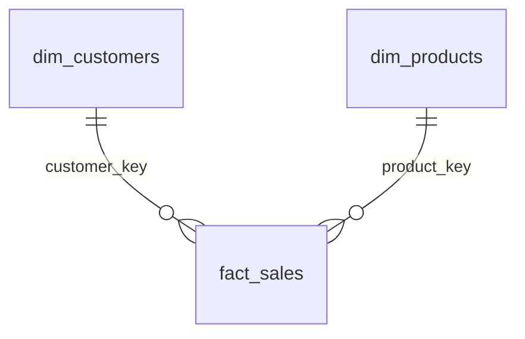

# 📚 Data Catalog: Gold Layer

## 🧭 Ringkasan

Gold Layer adalah representasi data tingkat bisnis yang disusun untuk mendukung kebutuhan analisis dan pelaporan. Layer ini terdiri dari **dimension table** dan **fact table** untuk metrik bisnis tertentu.

| Objek | Tipe | Fungsi |
|---|---|---|
| [`gold.dim_customers`](#-golddim_customers) | 👤 Dimension | Detail pelanggan dengan data demografis dan geografis |
| [`gold.dim_products`](#-golddim_products) | 📦 Dimension | Informasi produk beserta atributnya |
| [`gold.fact_sales`](#-goldfact_sales) | 💰 Fact | Transaksi penjualan untuk keperluan analisis |

**Legenda:** 🔑 = *surrogate key* · 🔗 = *foreign key* ke dimension table

---

## 🔀 Relasi Antar Tabel

---

## 👤 gold.dim_customers

**Tujuan:** Menyimpan detail pelanggan yang diperkaya dengan data demografis dan geografis.

| Nama Kolom | Tipe Data | Deskripsi |
|---|---|---|
| 🔑 `customer_key` | INT | *Surrogate key* yang mengidentifikasi setiap record pelanggan secara unik di dimension table. |
| `customer_id` | INT | Pengenal numerik unik yang diberikan kepada setiap pelanggan. |
| `customer_number` | NVARCHAR(50) | Pengenal alfanumerik pelanggan, digunakan untuk pelacakan dan referensi. |
| `first_name` | NVARCHAR(50) | Nama depan pelanggan sebagaimana tercatat di sistem. |
| `last_name` | NVARCHAR(50) | Nama belakang atau nama keluarga pelanggan. |
| `country` | NVARCHAR(50) | Negara tempat tinggal pelanggan (contoh: `Australia`). |
| `marital_status` | NVARCHAR(50) | Status pernikahan pelanggan (contoh: `Married`, `Single`). |
| `gender` | NVARCHAR(50) | Jenis kelamin pelanggan (contoh: `Male`, `Female`, `n/a`). |
| `birthdate` | DATE | Tanggal lahir pelanggan, dengan format `YYYY-MM-DD` (contoh: `1971-10-06`). |
| `create_date` | DATE | Tanggal saat record pelanggan dibuat di sistem. |

---

## 📦 gold.dim_products

**Tujuan:** Menyediakan informasi tentang produk beserta atributnya.

| Nama Kolom | Tipe Data | Deskripsi |
|---|---|---|
| 🔑 `product_key` | INT | *Surrogate key* yang mengidentifikasi setiap record produk secara unik di dimension table. |
| `product_id` | INT | Pengenal unik yang diberikan kepada produk untuk keperluan pelacakan dan referensi internal. |
| `product_number` | NVARCHAR(50) | Kode alfanumerik terstruktur yang merepresentasikan produk, sering dipakai untuk kategorisasi atau inventori. |
| `product_name` | NVARCHAR(50) | Nama deskriptif produk, mencakup detail penting seperti tipe, warna, dan ukuran. |
| `category_id` | NVARCHAR(50) | Pengenal unik kategori produk, yang terhubung ke klasifikasi tingkat atasnya. |
| `category` | NVARCHAR(50) | Klasifikasi umum produk (contoh: `Bikes`, `Components`) untuk mengelompokkan produk yang berkaitan. |
| `subcategory` | NVARCHAR(50) | Klasifikasi yang lebih rinci di dalam `category`, seperti tipe produk. |
| `maintenance` | NVARCHAR(50) | Menunjukkan apakah produk memerlukan perawatan (contoh: `Yes`, `No`). |
| `cost` | INT | Biaya atau harga dasar produk, dalam satuan mata uang. |
| `product_line` | NVARCHAR(50) | Lini atau seri produk tempat produk tersebut berada (contoh: `Road`, `Mountain`). |
| `start_date` | DATE | Tanggal produk mulai tersedia untuk dijual atau digunakan. |

---

## 💰 gold.fact_sales

**Tujuan:** Menyimpan data transaksi penjualan untuk keperluan analisis.

| Nama Kolom | Tipe Data | Deskripsi |
|---|---|---|
| `order_number` | NVARCHAR(50) | Pengenal alfanumerik unik untuk setiap order penjualan (contoh: `SO54496`). |
| 🔗 `product_key` | INT | *Surrogate key* yang menghubungkan order ke dimension table produk. |
| 🔗 `customer_key` | INT | *Surrogate key* yang menghubungkan order ke dimension table pelanggan. |
| `order_date` | DATE | Tanggal order dibuat. |
| `shipping_date` | DATE | Tanggal order dikirim ke pelanggan. |
| `due_date` | DATE | Tanggal jatuh tempo pembayaran order. |
| `sales_amount` | INT | Total nilai penjualan untuk satu line item, dalam satuan mata uang utuh (contoh: `25`). |
| `quantity` | INT | Jumlah unit produk yang dipesan untuk satu line item (contoh: `1`). |
| `price` | INT | Harga per unit produk untuk satu line item, dalam satuan mata uang utuh (contoh: `25`). |
