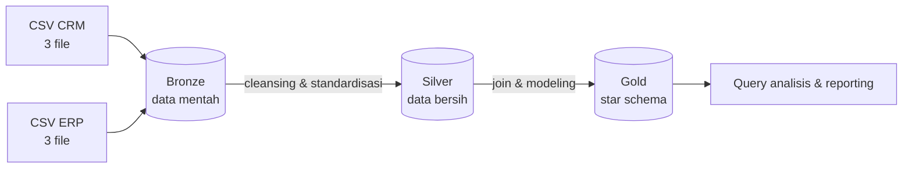

# 🏬 Sales Data Warehouse dengan SQL Server

Data warehouse penjualan yang dibangun dari dua sistem sumber (**CRM** dan **ERP**) memakai **SQL Server** dan **Medallion Architecture**. Data mentah berupa 6 file CSV diolah lewat tiga tahap hingga menjadi *star schema* yang siap dipakai untuk analisis.

> Proyek ini saya kerjakan dengan mengikuti tutorial [Data With Baraa](https://www.youtube.com/watch?v=9GVqKuTVANE). Detail kredit ada di bagian [Sumber & Kredit](#-sumber--kredit).

---

## ⚡ Sekilas

| | |
|---|---|
| **Database** | SQL Server Express, diakses lewat SSMS |
| **Sumber data** | 3 file CSV dari CRM + 3 file CSV dari ERP |
| **Arsitektur** | Bronze → Silver → Gold |
| **Output akhir** | 2 dimension table + 1 fact table (berbentuk *view*) |
| **Otomatisasi** | Stored procedure `bronze.load_bronze` dan `silver.load_silver` |

---

## 🔄 Alur Data



| Layer | Tujuan | Objek | Cara pengisian |
|---|---|---|---|
| **Bronze** | Menyimpan data apa adanya, tanpa diubah | 6 tabel | `BULK INSERT` dari CSV |
| **Silver** | Membersihkan dan menyeragamkan data | 6 tabel | `INSERT ... SELECT` dengan transformasi |
| **Gold** | Menyajikan data siap analisis | 3 view | `CREATE VIEW` dari tabel Silver |

---

## 📊 Hasil Load

Jumlah baris yang berhasil dimuat ke Bronze:

| Tabel Bronze | Baris | Sumber |
|---|--:|---|
| `crm_cust_info` | 18.493 | CRM |
| `crm_prd_info` | 397 | CRM |
| `crm_sales_details` | 60.398 | CRM |
| `erp_cust_az12` | 18.483 | ERP |
| `erp_loc_a101` | 18.484 | ERP |
| `erp_px_cat_g1v2` | 37 | ERP |

Isi Gold layer:

| Objek | Baris |
|---|--:|
| `gold.dim_customers` | 18.484 |
| `gold.dim_products` | 295 |
| `gold.fact_sales` | 60.398 |

`fact_sales` berjumlah sama dengan data penjualan asli, artinya tidak ada transaksi yang hilang saat proses join.

---

## 🧹 Masalah Data yang Ditangani di Silver

Data Bronze sengaja dibiarkan mentah, jadi semua perbaikan dilakukan di Silver. Beberapa contoh masalah yang ditemukan dan cara menanganinya:

| Masalah | Contoh | Penanganan |
|---|---|---|
| Spasi berlebih | `' Jon'`, `' Torres'` | `TRIM()` |
| Customer ID duplikat atau `NULL` | `cst_id` muncul lebih dari sekali | `ROW_NUMBER()` untuk mengambil record terbaru, lalu buang `NULL` |
| Nilai berupa singkatan | `M`, `S`, `F` | `CASE WHEN` menjadi `Married`, `Single`, `Female`, `Male`, `n/a` |
---

## ⭐ Data Model (Gold Layer)

Gold menggunakan *star schema*: satu *fact table* di tengah yang terhubung ke dua *dimension table*.

| Objek | Tipe | Isi |
|---|---|---|
| `gold.dim_customers` | Dimension | Data customer dari CRM, diperkaya data demografi dan negara dari ERP |
| `gold.dim_products` | Dimension | Data produk dari CRM, diperkaya kategori dan subkategori dari ERP |
| `gold.fact_sales` | Fact | Transaksi penjualan, terhubung lewat `customer_key` dan `product_key` |

Dokumentasi lengkap setiap kolom ada di [`02_docs/data_catalog.md`](02_docs/data_catalog.md).

---

## ✅ Validasi Kualitas Data

Setiap layer dicek sebelum dilanjutkan ke layer berikutnya:

- **Silver:** tidak ada duplikat atau `NULL` pada primary key, tidak ada spasi tersisa, dan nilai kategori sudah seragam.
- **Gold:** tidak ada duplikat *surrogate key*, dan setiap baris `fact_sales` berhasil terhubung ke dimension-nya.

Script pengecekannya ada di folder [`04_tests/`](04_tests).

---

## 🗂️ Struktur Folder

```text
.
├── 01_datasets/        # 6 file CSV sumber (source_crm, source_erp)
├── 02_docs/            # Diagram, data catalog, dan dokumentasi
├── 03_scripts/
│   ├── init_database.sql
│   ├── bronze/         # DDL + stored procedure load
│   ├── silver/         # DDL + stored procedure load
│   └── gold/           # DDL view
├── 04_tests/           # Quality check Silver dan Gold
└── README.md
```

---

## ▶️ Cara Menjalankan

1. Pasang **SQL Server** dan **SSMS**.
2. Letakkan folder `01_datasets` di `C:\sql\dwh_project\01_datasets\`, atau ubah path di `proc_load_bronze.sql`.
3. Jalankan script sesuai urutan:

```text
1. init_database.sql             -> buat database & schema
2. bronze/ddl_bronze.sql         -> buat tabel Bronze
3. bronze/proc_load_bronze.sql   -> buat procedure
4. EXEC bronze.load_bronze;      -> load CSV ke Bronze
5. silver/ddl_silver.sql         -> buat tabel Silver
6. silver/proc_load_silver.sql   -> buat procedure
7. EXEC silver.load_silver;      -> bersihkan & load ke Silver
8. gold/ddl_gold.sql             -> buat view Gold
9. 04_tests/*.sql                -> validasi hasil
```

### Kendala yang Mungkin Muncul

- **Tabel Bronze kosong setelah script dijalankan.** Menjalankan script hanya membuat procedure-nya. Datanya baru masuk setelah `EXEC bronze.load_bronze;` dijalankan.
- **Error tidak muncul padahal data gagal masuk.** Error pada procedure ditangkap oleh blok `CATCH` dan hanya di-`PRINT`. Cek tab **Messages** di SSMS.
- **Garis merah di editor SSMS padahal query berhasil.** Itu cache IntelliSense yang belum diperbarui. Tekan `Ctrl + Shift + R`.

---

## 🧰 Tools

SQL Server Express · SQL Server Management Studio (SSMS) · Git & GitHub · draw.io

---

## 📜 Sumber & Kredit

Proyek ini mengikuti tutorial **Building a Modern Data Warehouse** dari **Baraa Khatib Salkini (Data With Baraa)**. Konsep, arsitektur, dan dataset berasal dari materi tersebut.

- 🎥 [Tutorial di YouTube](https://www.youtube.com/watch?v=9GVqKuTVANE)
- 📦 [Repository asli](https://github.com/DataWithBaraa/sql-data-warehouse-project)
- 🛡️ Lisensi: [MIT](LICENSE)

[](https://github.com/DataWithBaraa/sql-data-warehouse-project)

---

## 👤 Penulis

**Mutia Septianingsih** · [LinkedIn](https://linkedin.com/in/mutiaseptia) · [GitHub](https://github.com/mutiaseptiaproject)
